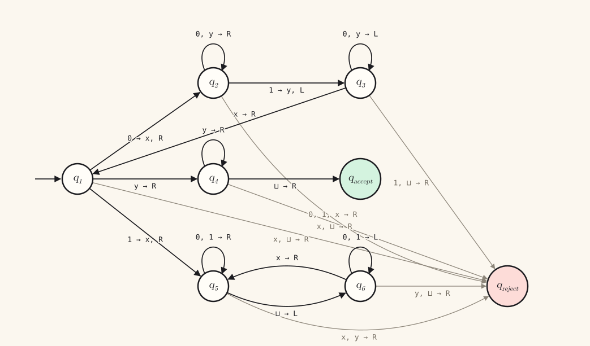
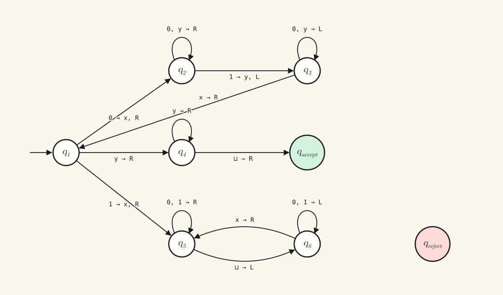

# Inciso b) Máquina con aceptación, rechazo y ciclo infinito

## Descripción informal

M = "Sobre la cadena de entrada w:

1. Si w empieza con 1, marcar ese 1 con x e ir y venir entre la x y el primer ⊔, para siempre.
2. Si w = ε, rechazar.
3. Marcar con x el 0 más a la izquierda y buscar hacia la derecha el primer 1. Si no hay, rechazar; si lo hay, marcarlo con y.
4. Regresar a la última x y repetir la etapa 3 mientras queden 0 sin marcar.
5. Cuando ya no queden 0, recorrer las y. Si aparece un 0 o un 1, rechazar; si se llega a ⊔, aceptar."

L(M) = {0ⁿ1ⁿ | n ≥ 1}. M **reconoce** L(M) pero **no lo decide** (Definiciones 9 y 10): con las cadenas que empiezan con 1 no se detiene.

## Descripción formal

M = (Q, Σ, Γ, δ, q₁, qaccept, qreject), donde

- Q = {q₁, q₂, q₃, q₄, q₅, q₆, qaccept, qreject}
- Σ = {0, 1}
- Γ = {0, 1, x, y, ⊔}
- el estado inicial es q₁, el de aceptación qaccept y el de rechazo qreject.

δ está definida en todo (Q − {qaccept, qreject}) × Γ:

| δ | 0 | 1 | x | y | ⊔ |
|---|---|---|---|---|---|
| q₁ | (q₂, x, R) | (q₅, x, R) | (qreject, x, R) | (q₄, y, R) | (qreject, ⊔, R) |
| q₂ | (q₂, 0, R) | (q₃, y, L) | (qreject, x, R) | (q₂, y, R) | (qreject, ⊔, R) |
| q₃ | (q₃, 0, L) | (qreject, 1, R) | (q₁, x, R) | (q₃, y, L) | (qreject, ⊔, R) |
| q₄ | (qreject, 0, R) | (qreject, 1, R) | (qreject, x, R) | (q₄, y, R) | (qaccept, ⊔, R) |
| q₅ | (q₅, 0, R) | (q₅, 1, R) | (qreject, x, R) | (qreject, y, R) | (q₆, ⊔, L) |
| q₆ | (q₆, 0, L) | (q₆, 1, L) | (q₅, x, R) | (qreject, y, R) | (qreject, ⊔, R) |

Papel de cada estado:

| Estado | Función |
|---|---|
| q₁ | Marca con x el siguiente 0; si ve y, ya no quedan 0; si w empieza con 1, entra al ciclo |
| q₂ | Avanza a la derecha sobre 0 e y hasta el primer 1 y lo marca con y |
| q₃ | Regresa a la izquierda hasta la última x |
| q₄ | Verifica que a la derecha solo queden y, hasta ⊔ |
| q₅ | Ciclo, ida: avanza a la derecha hasta ⊔ |
| q₆ | Ciclo, vuelta: regresa a la izquierda hasta la x |

## Diagrama de estados

Notación de clase: «a → b, D» lee a, escribe b y mueve D; «a → D» deja el símbolo igual.



La misma máquina con la convención de los diagramas de clase, donde las transiciones que no se dibujan van a qreject:



Los dos SVG se generan con `npm run diagrama` a partir de `ejemplos/inciso-b-acepta.txt`.

## Archivos de entrada

Los tres archivos tienen la misma máquina y solo cambian w. Las salidas completas están en `resultados/`.

| Archivo | w | Resultado | Última configuración |
|---|---|---|---|
| `ejemplos/inciso-b-acepta.txt` | 000111 | Acepta en 25 pasos | C₂₆ = xxxyyy⊔qaccept |
| `ejemplos/inciso-b-rechaza.txt` | 00011 | Rechaza en 18 pasos (sobra un 0) | C₁₉ = xxxyy⊔qreject |
| `ejemplos/inciso-b-ciclo.txt` | 1100 | No se detiene | C₁₃ = C₅ = x100q₅⊔ |

## Por qué w = 1100 no se detiene

```
C₁  = q₁1100
C₂  = xq₅100      δ(q₁, 1) = (q₅, x, R)
C₃  = x1q₅00      δ(q₅, 1) = (q₅, 1, R)
C₄  = x10q₅0      δ(q₅, 0) = (q₅, 0, R)
C₅  = x100q₅⊔     δ(q₅, 0) = (q₅, 0, R)
C₆  = x10q₆0⊔     δ(q₅, ⊔) = (q₆, ⊔, L)
C₇  = x1q₆00⊔     δ(q₆, 0) = (q₆, 0, L)
C₈  = xq₆100⊔     δ(q₆, 0) = (q₆, 0, L)
C₉  = q₆x100⊔     δ(q₆, 1) = (q₆, 1, L)
C₁₀ = xq₅100⊔     δ(q₆, x) = (q₅, x, R)
C₁₁ = x1q₅00⊔     δ(q₅, 1) = (q₅, 1, R)
C₁₂ = x10q₅0⊔     δ(q₅, 0) = (q₅, 0, R)
C₁₃ = x100q₅⊔     δ(q₅, 0) = (q₅, 0, R)   ← igual a C₅
```

C₁₃ = C₅. Como M es determinista, cada configuración produce exactamente una configuración, así que la secuencia C₅, …, C₁₂ se repite para siempre y M nunca llega a una configuración de aceptación ni de rechazo. Lo mismo ocurre con cualquier w que empiece con 1: en esa rama q₅ solo encuentra 0, 1 y ⊔, y q₆ solo encuentra 0, 1 y x; ninguna de esas transiciones va a qaccept ni a qreject.
